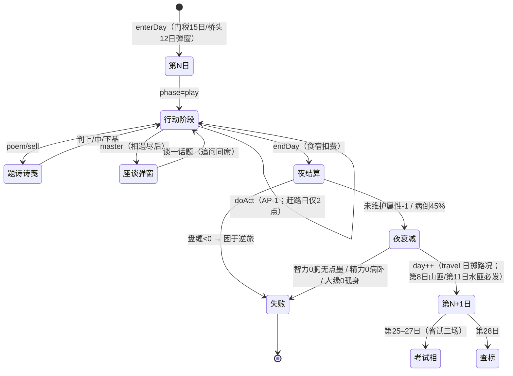
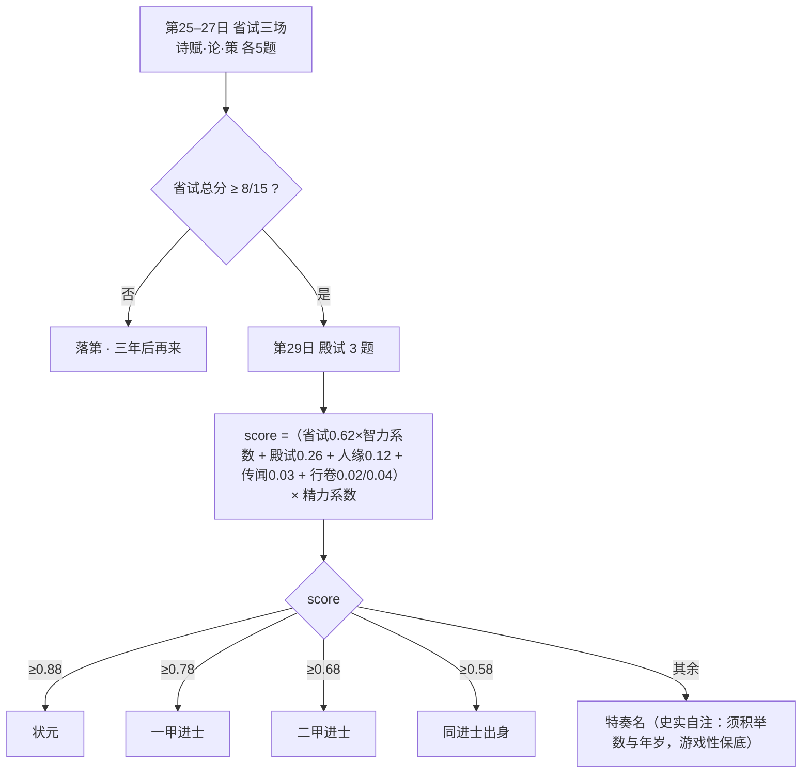
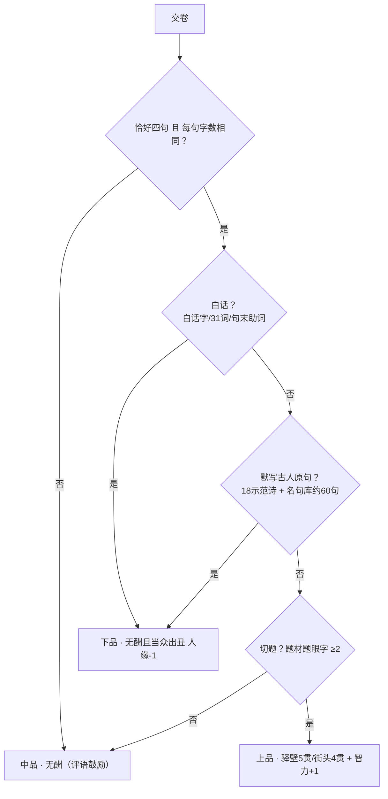

# 北宋赶考记 · 架构示意（Mermaid）

生成于 2026-11（Week 10 作业：项目示意图）。GitHub 原生渲染 Mermaid；本文件描述的三张图即游戏的核心机制闭环。

## 1. 日循环状态机（endDay 主循环）

每一天是一台小状态机：行动 → 夜结算 → 推进。四条失败线全部挂在夜结算之后。

## 2. 考试与结局流程（省试 → 殿试 → 六档）

## 3. 题诗四重判定（gradePoem，三档）

## 分层

- **数据**：`data/quiz_150.json`（题库）、`data/glossary.json`（词条两档出处）
- **核心逻辑**：`game.template.html` 内 SCENES/ACT/EVENTS/NPCS/DIALOGUES/gradePoem/endDay（无 DOM 依赖，可无头测试）
- **渲染**：render()/overlay 弹窗/SCENE_ART 场景插图
- **构建**：`build.py`（模板+数据+图 → 单文件 HTML）
- **测试**：`sim.js`/`walkthrough_test.js`/`poem_test.js`/`dialogue_test.js`（osascript 无头，见 AGENTS.md 一键回归）
